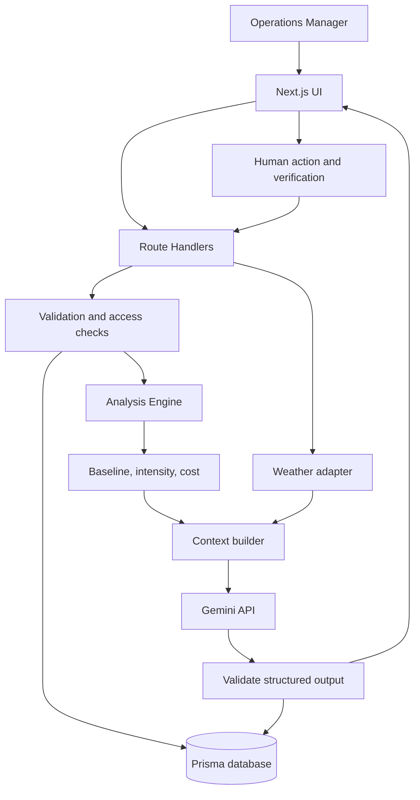

# Architecture — OpsMind
Versi 0.1 · Monolith modular

## Prinsip
- Mulai dengan satu aplikasi Next.js.
- Kalkulasi deterministik di backend; LLM bukan kalkulator.
- Gemini tidak punya akses SQL bebas.
- Insight dapat ditelusuri ke record dan rumus.
- AI menyarankan, manusia memutuskan.
- Bedakan data simulasi dan data live.

## Component diagram


## Investigation flow
1. UI mengirim company/date atau anomaly ID.
2. Backend validasi request dan mengambil data.
3. Analysis Engine menghitung intensity, baseline, deviasi, dan estimasi biaya.
4. Weather adapter mengembalikan cuaca atau status unavailable/simulated.
5. Context builder mengemas fakta, unit, sumber, dan asumsi.
6. Backend memanggil Gemini.
7. Server memvalidasi JSON hasil AI.
8. Investigasi disimpan dan dikembalikan ke UI.
9. Kegagalan model ditampilkan sebagai failed, bukan jawaban palsu.

## Struktur modul yang disarankan
```text
src/
  app/api/{companies,operational-data,anomalies,investigations,actions}/
  components/{dashboard,anomalies,investigation,actions}/
  lib/analysis/{energy-intensity,baseline,anomaly-detection,cost-impact}.ts
  lib/ai/{gemini-client,investigation-prompt,investigation-schema}.ts
  lib/weather/{provider,mock-provider}.ts
  lib/services/investigation-service.ts
prisma/schema.prisma
prisma/seed.ts
tests/
```
Sesuaikan dengan struktur repo yang sudah ada; jangan menimpa kode yang berfungsi.

## Draft API
- `GET /api/companies`
- `GET /api/operational-data?companyId=...&from=YYYY-MM-DD&to=YYYY-MM-DD`
- `GET /api/anomalies?companyId=...&from=...&to=...`
- `POST /api/investigations` body: `{ "companyId": "...", "date": "2026-09-17" }`
- `POST /api/actions`
- `POST /api/verifications`

## Deployment
Next.js container di Cloud Run. Simpan secret di Secret Manager atau konfigurasi secret platform. Database managed bila waktu/akses memungkinkan. Firebase Auth opsional. Jangan taruh API key Gemini di frontend.

## Failure handling
- Database gagal: error aman + log correlation ID.
- Cuaca gagal: tandai unavailable dan lanjutkan tanpa konteks cuaca.
- Gemini timeout/invalid JSON: status failed, tidak ada hasil palsu.
- Data tidak cukup: `insufficient_data`.
- Output model selalu dianggap input tidak tepercaya.

## Trust boundaries
Validasi semua input server-side; batasi ukuran data yang dikirim ke model; jangan mengeksekusi SQL, shell, atau kode yang ditulis AI; jangan log secret.
